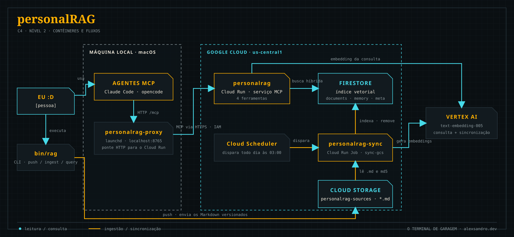

Há algum tempo eu queria criar meu próprio RAG, então criei o personalRAG.

De forma bem básica, fiz isso para dois usos: absorver livros e armazenar conversas com agentes, sintetizadas como “memórias”.

Para os livros, uso a ferramenta [book-to-skill](https://github.com/virgiliojr94/book-to-skill), que já mencionei [em outro HEA](). Já o contexto das conversas com agentes fica em Markdown, no formato que seria armazenado na memória do meu agente local.

Com essas duas fontes, armazeno tudo no Google Firestore e recupero quando preciso, por meio de um MCP simples que combina busca vetorial e lexical.

